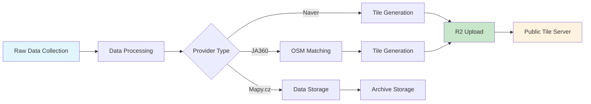

# StreetRadar Data Engine

A comprehensive data collection and processing pipeline for street-level imagery from multiple mapping providers. This system collects panoramic street view data, processes it into standardized formats, and generates optimized tile sets for web applications.

## 🌍 Supported Providers

| Provider | Data Collection | Processing | OSM Matching | Tile Generation | R2 Upload |
|----------|:---------------:|:----------:|:------------:|:---------------:|:---------:|
| **JA360** (Iceland) | ✅ | ✅ | ✅ | ✅ | ✅ |
| **Naver** (South Korea) | ✅ | ✅ | ❌ | ✅ | ✅ |
| **Mapy.cz** (Czech Republic) | ✅ | ✅ | ❌ | ❌ | ❌ |

## 🏗️ Architecture Overview

As of now, the architecture looks like this:



## 📁 Data Structure

```
data/
├── ja360/
│   ├── raw/           # Raw collected data
│   ├── processed/     # Cleaned and processed data
│   ├── matched/       # OSM-matched data
│   └── tile/          # Generated PMTiles
├── naver/
│   ├── raw/           # Session-based raw tiles
│   ├── processed/     # Processed coverage data
│   └── tile/          # Generated PMTiles
└── mapy/
    ├── raw/           # Raw panorama data
    └── processed/     # Processed data
```

## 🛠️ Development

### Code Structure

- `dags/` - Airflow DAG definitions
- `scripts/` - Individual processing scripts for each provider
- `streetlevel/` - Core library for street-level data handling
- `airflow/` - Airflow configuration and logs